# EZ AzFW Manager

A cross-platform desktop app for managing Azure Firewalls, policies, rules and IP groups.

**Stage changes locally, review them, then commit to Azure.**

[](https://github.com/samsmith-MSFT/ez-azfw-manager/releases/latest)
[](https://github.com/samsmith-MSFT/ez-azfw-manager/actions/workflows/ci.yml)
[](LICENSE)

**[Download the latest release](https://github.com/samsmith-MSFT/ez-azfw-manager/releases/latest)** for Windows, macOS or Linux.

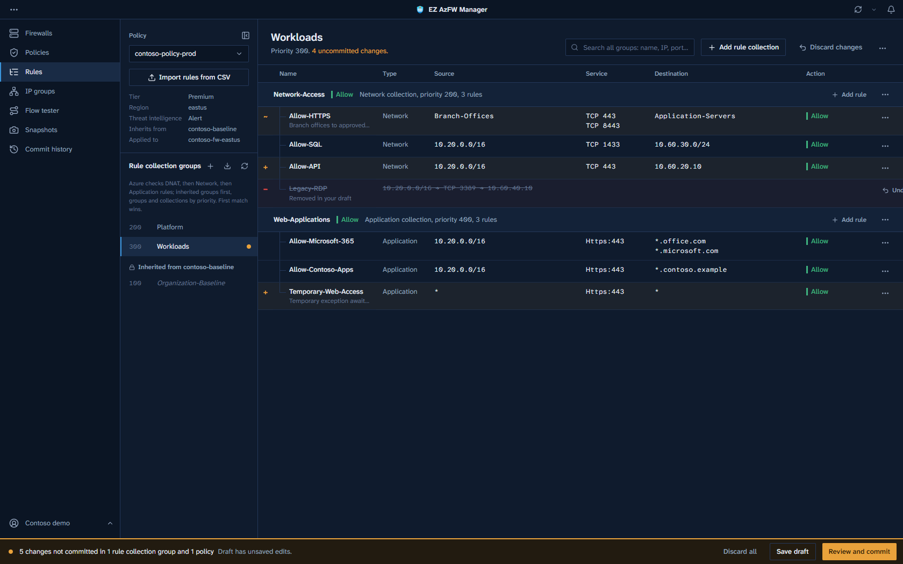

## What you can do

- Browse firewalls, policies and IP groups across subscriptions with consistent filters.
- Create and edit network, application and DNAT rules, including bulk CSV import and export.
- Review duplicate rules, potential overlaps and risky changes before committing.
- Configure policy threat intelligence, DNS proxy, allowlists, SNAT auto-learning and Premium TLS inspection.
- Manage firewall scaling, Route Server association, maintenance assignments and start/stop.
- Save shared commit history and policy snapshots, and stage rollbacks.
- Test which rule would match a traffic flow, including inherited rules and your draft.
- Deploy new firewalls and create IP groups with validated input.
- Watch live firewall logs from an Event Hub, with a guided setup for the Event Hub and diagnostic setting.

## Download and run

Choose the file for your operating system and processor on the [release page](https://github.com/samsmith-MSFT/ez-azfw-manager/releases/latest).

| Platform | Download                                       | Run                                          |
| -------- | ---------------------------------------------- | -------------------------------------------- |
| Windows  | Installer or portable executable, x64 or Arm64 | Run setup, or double-click the portable file |
| macOS    | ZIP for Apple silicon or Intel                 | Unzip and open **EZ AzFW Manager.app**       |
| Linux    | x64 AppImage                                   | Make the file executable, then run it        |

The Windows installer needs administrator rights and adds shortcuts and an uninstaller. New installations use **EZ AzFW Manager** as the folder name; upgrades may retain an existing installation path. Uninstalling keeps your saved data.

### First launch on each OS

Builds are currently unsigned, so Windows SmartScreen or macOS Gatekeeper may show a warning. Verify the download against the release's `SHA256SUMS.txt` before running it.

- **Windows:** use **More info → Run anyway** if you trust the verified download.
- **macOS:** right-click the app and choose **Open**, or use **Privacy & Security → Open Anyway**.
- **Linux:** AppImages need FUSE 2; newer Ubuntu versions may also require an AppArmor allowance.

## Basic workflow

1. Sign in with a Microsoft account or an existing Azure CLI session, then select your directory and firewalls.
2. Edit rules or configuration. **Save draft** keeps changes on your device; amber marks uncommitted changes.
3. Use **Review and commit** to inspect changes and warnings before applying them to Azure.
4. Check **Commit history** or **Snapshots** to review previous changes.

**IP group creation and new-resource deployment are separate operations that write directly to Azure.**

To find policy DNS proxy and other settings, open **Policies → ⋯ on the policy row → Edit policy settings**. For firewall settings, click its name on the **Firewalls** page.

### CSV import

In **Rules**, choose **Import rules from CSV → Download template**. Fill in the template, save as UTF-8 CSV, and review the preview before importing to your draft.

- IP groups require their **full Azure resource IDs**, not names.
- Flagged rules are skipped by default; explicitly choose replacements or imports where appropriate.
- Overlap warnings are advisory, not proof of which rule Azure will apply.

### Firewall logs

The **Firewall logs** tab streams Azure Firewall diagnostic logs from an Event Hub, using your own sign-in. Nothing is stored in a connection string or key, and rows are kept in memory only: the newest 5,000, cleared when you sign out or switch directory. **Export CSV** writes the rows shown to a file you choose.

- Pick a hub the app detected from your firewalls' diagnostic settings, or type a namespace and event hub.
- **Set up logging…** creates the Event Hub and the firewall's diagnostic setting for you. Review lists every change before anything happens; the setting is merged with the existing one, never replaced, and the app sends the rule categories plus the threat intelligence, IDPS and DNS categories the firewall offers. FlowTrace and FatFlow are opt-in because they are very noisy.
- A firewall's Event Hub must be in the **same region** as the firewall, and a firewall can have at most **five** diagnostic settings.
- A diagnostic setting that sends to a deleted namespace is flagged, and **Clean up…** removes it.
- A namespace with **public network access disabled** (private endpoints only) is flagged in the setup review and on the connection form: the app reads logs over the public endpoint, so it connects only from a network with a private endpoint route to it.
- For a row from a firewall you manage, the details panel shows the policy it uses. **Open rule** goes to the rule collection group of the rule the row matched (it does not open the rule for editing). On a denied network or application rule row, **Create an Allow rule…** opens the rule editor with a rule for exactly that flow: you choose a rule collection group and an Allow collection (or a new one), and it warns when a Deny rule would still win, for example one in a parent policy. IPv6 flows and other row types are not offered. The rule goes into your draft; review and commit as usual.
- Reading needs outbound access on port 5671 to `*.servicebus.windows.net`. The first events can take 10 to 15 minutes after setup, and a new role can take a few minutes to apply.
- Cost: the wizard creates a **Basic** namespace by default (about $11 per month, one throughput unit) or **Standard** (about $22 per month), plus about $0.03 per million events. These are US list prices and vary by region and agreement; see [Event Hubs pricing](https://azure.microsoft.com/pricing/details/event-hubs/). There is no automatic removal; delete the namespace when you no longer need it.

**Set up logging and Clean up write directly to Azure, not through your draft**, like IP group creation and deployment. Rules created from a log row do go through your draft.

### Before changing live resources

- Stopping a firewall interrupts traffic. Restart can change its private IP or be delayed by capacity; public IP and other resource charges can continue while stopped.
- DNS proxy/custom DNS require Standard or Premium; TLS inspection requires Premium and existing certificate/identity access.
- Maintenance configurations, Route Servers, TLS certificates and identities must already exist. Commit a VNet Route Server association before enabling SNAT auto-learning.
- Avoid simultaneous edits from other tools while committing, and test changes in a non-production environment first.

## Azure permissions

The app uses your own Azure permissions.

| Task                                          | Typical permissions                                                                        |
| --------------------------------------------- | ------------------------------------------------------------------------------------------ |
| Browse resources                              | **Reader** on the relevant subscriptions or resource groups                                |
| Edit network resources and IP groups          | **Network Contributor**, including access to referenced IP groups and allocation resources |
| Deploy resources                              | **Contributor** on the target resource group; subscription access if creating groups       |
| Read/write shared snapshots and history       | **Storage Blob Data Contributor** on the chosen storage account                            |
| Create snapshot storage and grant blob access | **Contributor** plus **Owner** or **User Access Administrator** for role assignment        |
| Read live firewall logs                       | **Azure Event Hubs Data Receiver** on the event hub or namespace (Reader is not enough)    |
| Set up logging (Event Hub and diagnostic)     | **Contributor** on the resource group, **Monitoring Contributor** on the firewall          |
| Assign yourself the Data Receiver role        | **Owner** or **User Access Administrator** on the event hub                                |
| Clean up a deleted destination                | **Monitoring Contributor** on the firewall                                                 |

Maintenance assignments need the corresponding read/write/delete permissions. TLS setup also requires identity-assignment permission, and the selected identity must already have Key Vault secret access.

## Saved data and privacy

Drafts, preferences and restart references stay in your user profile under the legacy `ez-azfw-ruleman` folder, preserving data from older versions. Saved sign-in is encrypted with the OS key store; without a secure key store, it lasts for the session only.

Policy snapshots and shared history use an Azure Blob Storage account you choose. Configure this on the **Snapshots** page before committing; the account needs separate snapshot and history containers.

Firewall logs are held in memory only, never written to disk unless you export them. Log rows contain client IP addresses and destinations, so treat an exported CSV as sensitive.

The app sends no telemetry or data to the maintainers. It connects to Microsoft Entra ID, Azure Resource Manager, your selected Azure Blob Storage and, for Firewall logs, your Event Hubs namespace, using your sign-in.

## Screenshots

All screenshots use fictional Contoso demo data, not a real Azure environment.

<details>
<summary>Firewalls and policy settings</summary>

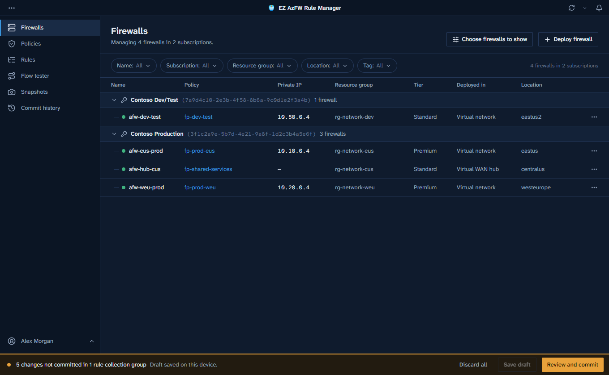
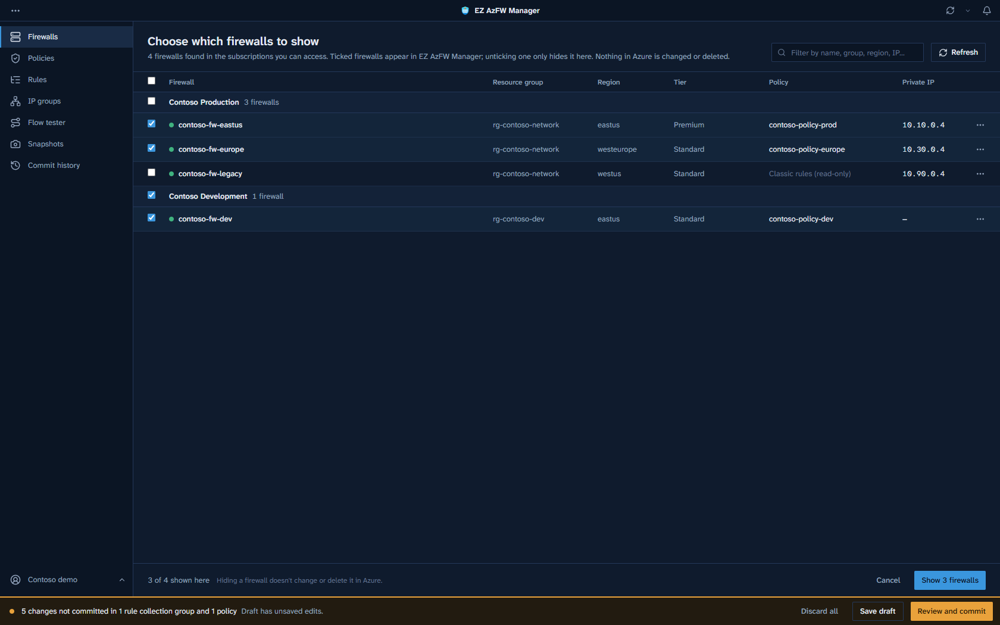
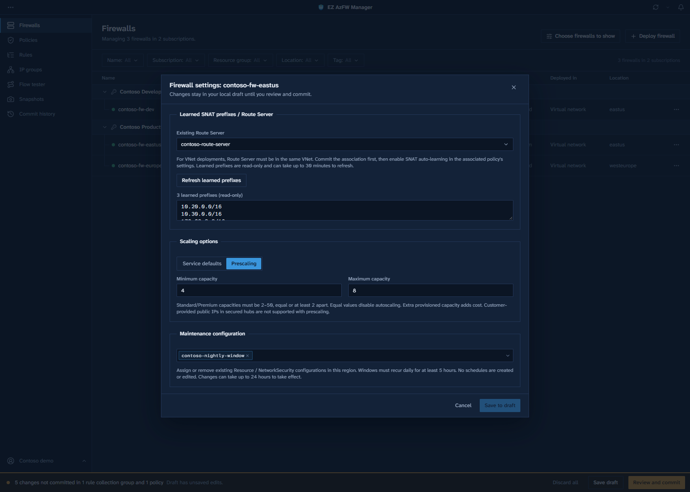
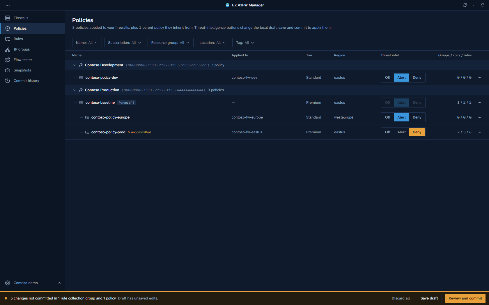
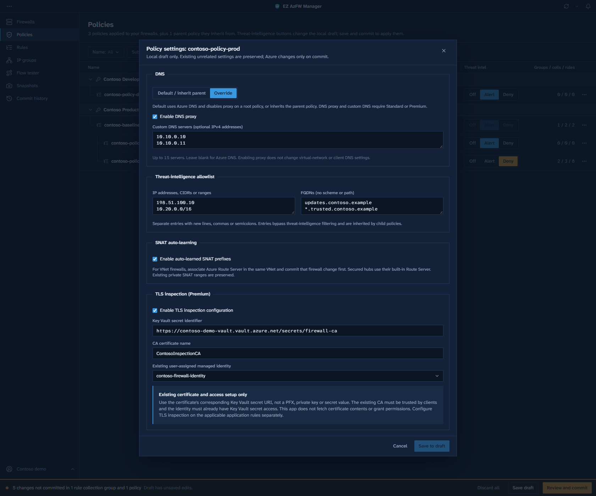

</details>

<details>
<summary>IP groups and CSV import</summary>

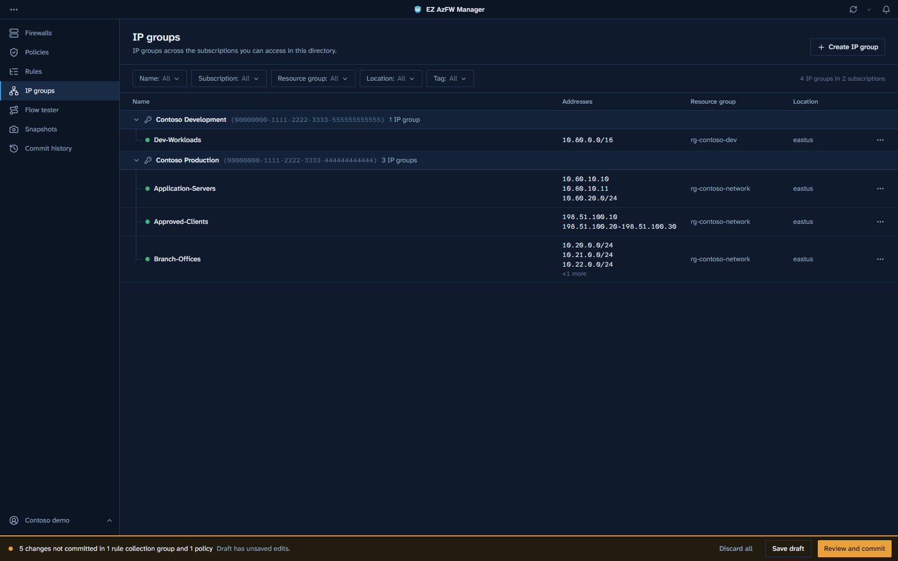
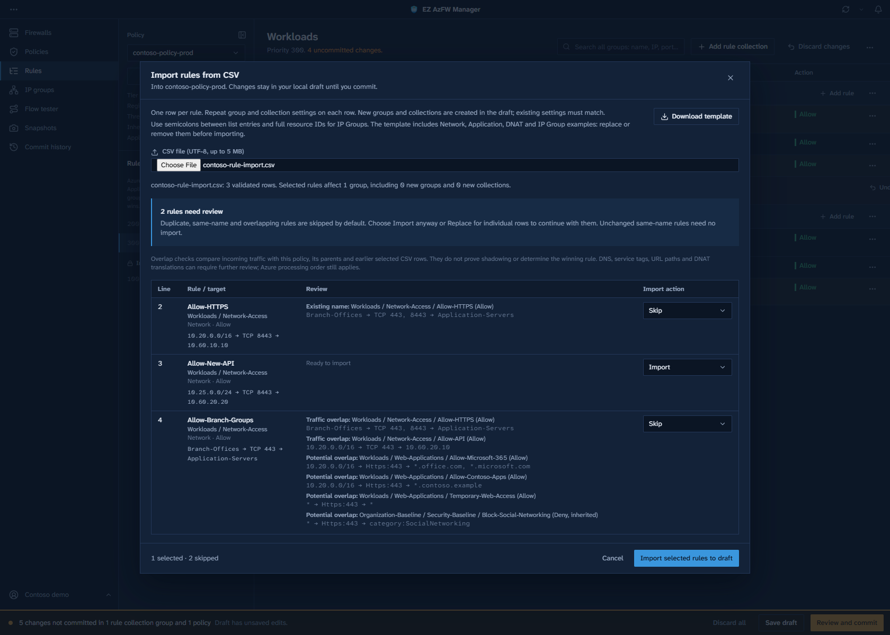

</details>

<details>
<summary>Rule editing and commit review</summary>

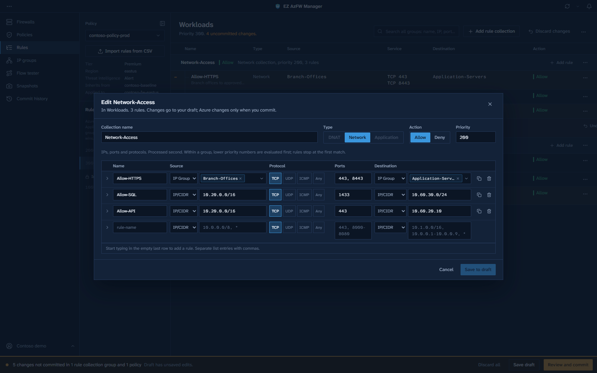
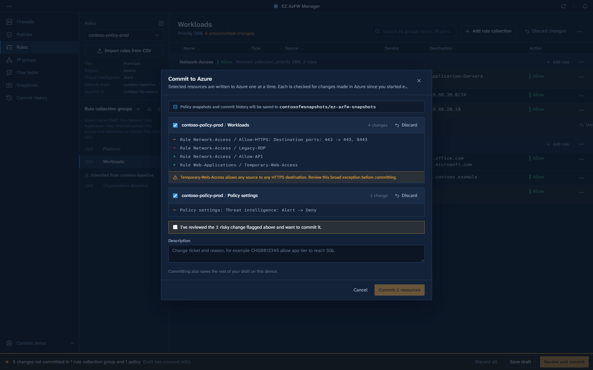

</details>

<details>
<summary>Flow testing, snapshots and shared history</summary>

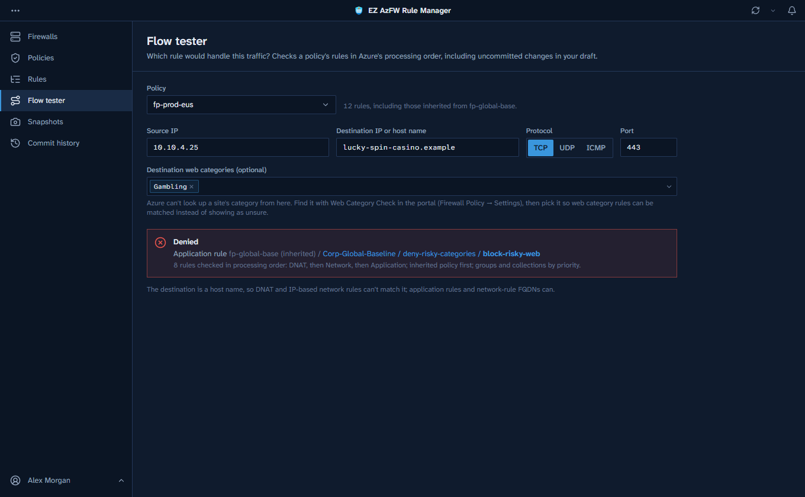
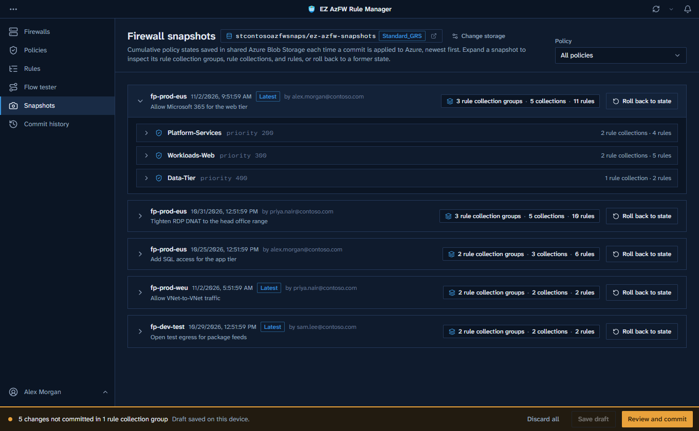
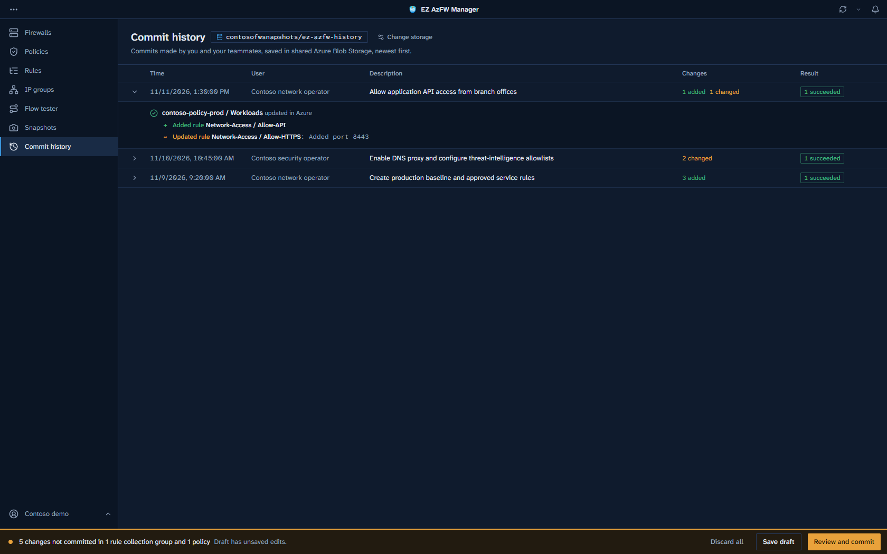

</details>

## Code signing policy

Free code signing is provided by [SignPath.io](https://about.signpath.io), with a certificate from the [SignPath Foundation](https://signpath.org). **Signing is applied for but not yet active; current builds are unsigned.**

- **Scope:** Windows executables built by this repository's [Release workflow](.github/workflows/release.yml).
- **Authors, reviewers and approvers:** [samsmith-MSFT](https://github.com/samsmith-MSFT). Signing requires manual approval.
- **Privacy:** no data is sent to maintainers; network access is limited to the Azure services you use.
- **System changes:** portable builds need no installation; Windows setup adds the app, shortcuts and an uninstall entry.

## Development and contributions

Use a current Node.js LTS release and npm:

```sh
npm ci
npm start
npm run verify
```

See [CONTRIBUTING.md](CONTRIBUTING.md) for development and release instructions, [CHANGELOG.md](CHANGELOG.md) for changes, and [SECURITY.md](SECURITY.md) for private vulnerability reporting.

## License and disclaimer

[MIT](LICENSE) © 2026 samsmith-MSFT. This software is provided as-is and can affect network connectivity and security; review changes and keep backups.

The Firewall logs parser is ported from [az-firewall-watch](https://github.com/cloudchristoph/az-firewall-watch) by CloudChristoph (MIT), which builds on [azure-firewall-mon](https://github.com/nicolgit/azure-firewall-mon) by Nicola Delfino (MIT). See [NOTICE](NOTICE).

This is not an official Microsoft product. Azure and Azure Firewall are Microsoft trademarks.
