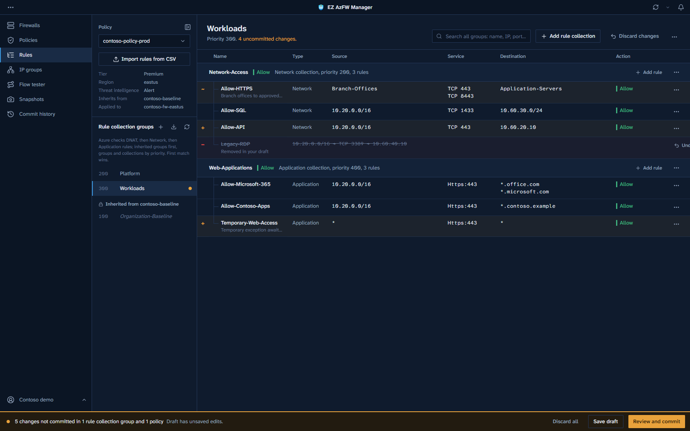
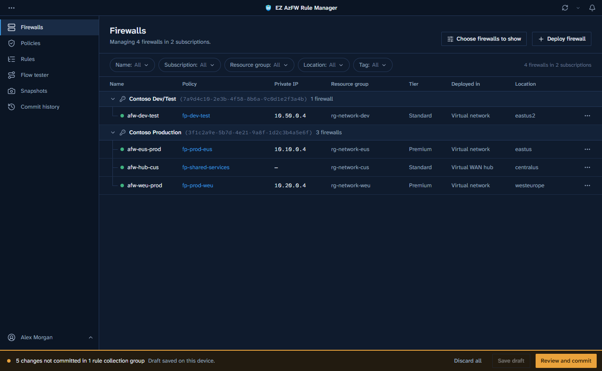
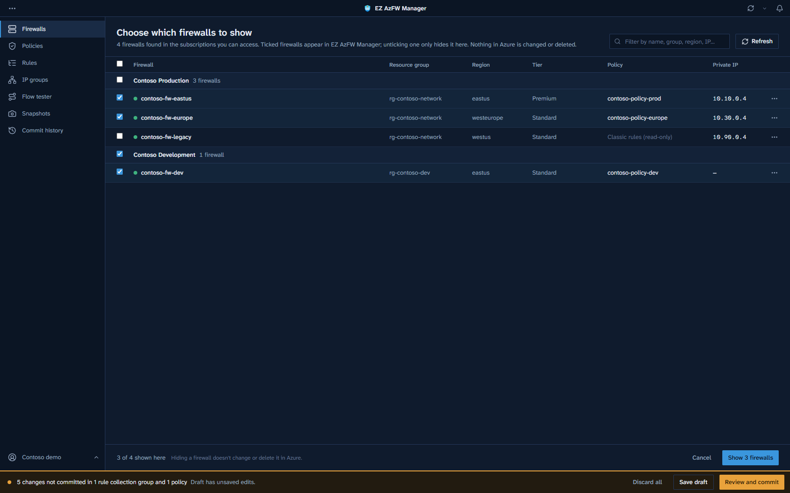
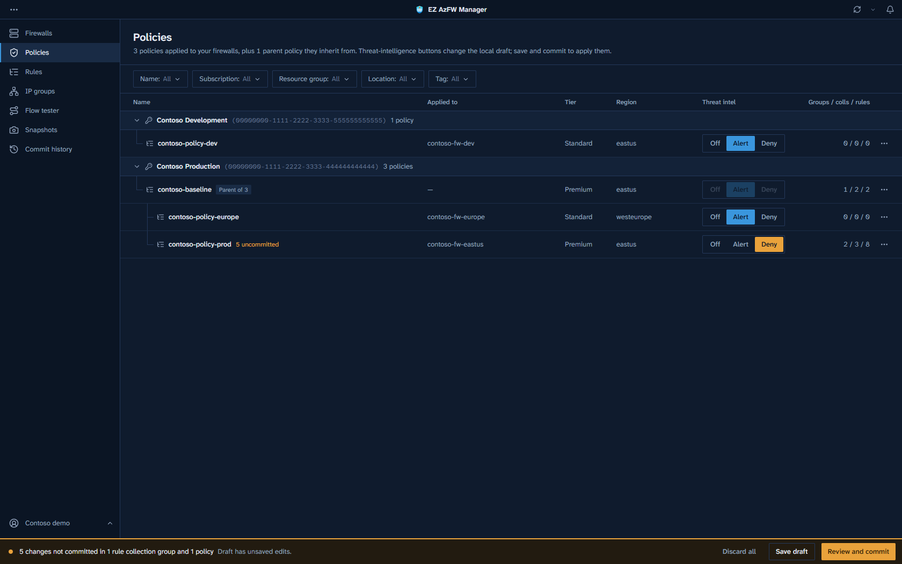
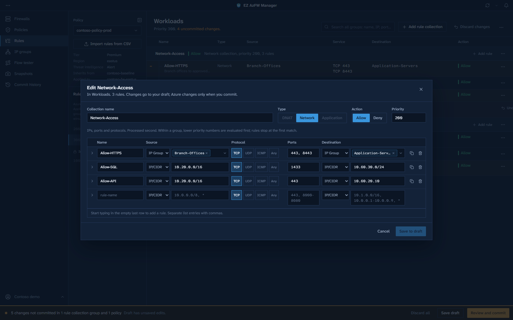
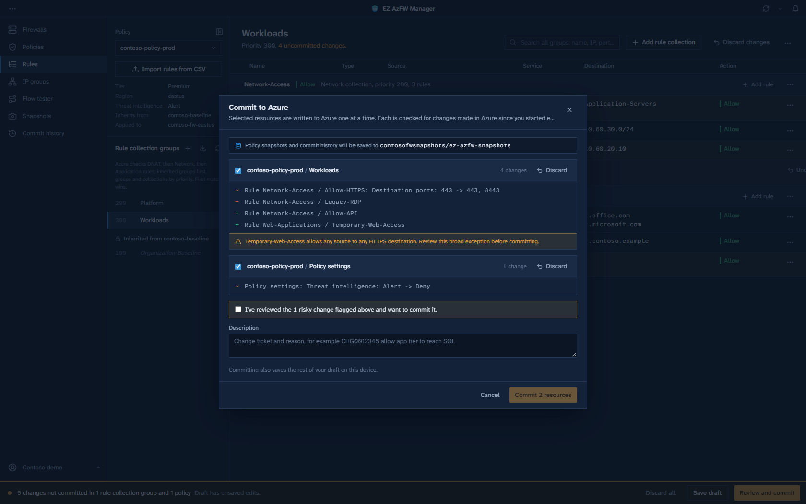
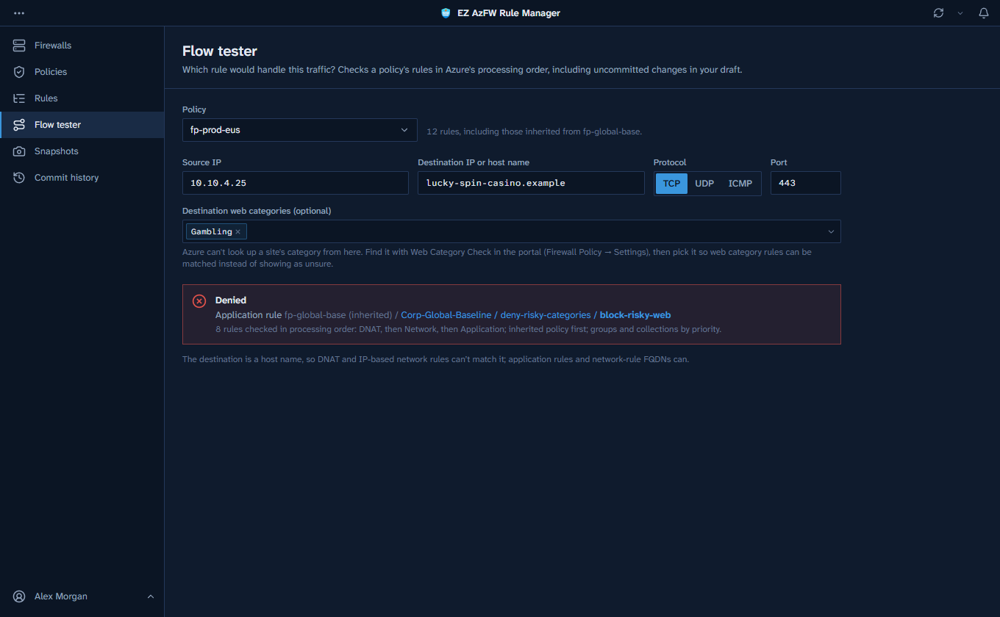
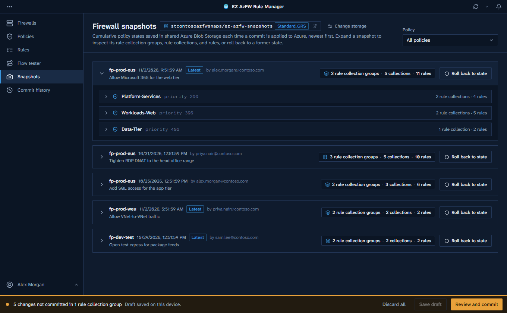
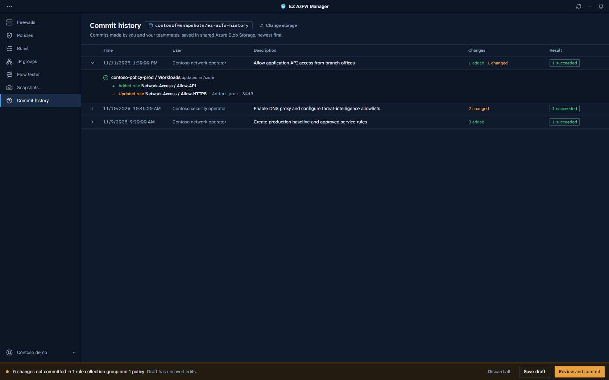

# EZ AzFW Manager

A cross-platform desktop app for managing [Azure Firewalls](https://learn.microsoft.com/azure/firewall/overview), policies, rules and IP groups, with a safe **draft → review → commit** workflow for rule and configuration changes.

Instead of editing rules live in the Azure portal, you stage changes locally as a _candidate_, review the risk and the exact diff, and then commit them to Azure in one step, with a shared history of every commit.

[](https://github.com/samsmith-MSFT/ez-azfw-manager/releases/latest)
[](https://github.com/samsmith-MSFT/ez-azfw-manager/actions/workflows/ci.yml)
[](LICENSE)

**[⬇ Download the latest version](https://github.com/samsmith-MSFT/ez-azfw-manager/releases/latest)** for Windows, macOS or Linux. On Windows, use the installer or the portable file; on macOS and Linux, download it and run it.

**Jump to:** [Features](#features) · [Screenshots](#screenshots) · [Download](#download-and-run) · [Signing in](#signing-in) · [Permissions](#required-azure-permissions) · [Data storage](#where-your-data-is-stored) · [Code signing policy](#code-signing-policy) · [Development](#development) · [Releasing](#releasing) · [Contributing](#contributing) · [Disclaimer](#disclaimer) · [License](#license)



_Editing a policy: draft changes are marked as added (+), changed (~) or removed (-), and nothing reaches Azure until you commit._

## Features

- **Sign in your way**: interactive browser sign-in (Microsoft Entra ID via MSAL) or reuse an existing Azure CLI session. Switch between directories (tenants) you have access to.
- **Discovery**: finds Azure Firewalls and Firewall Policies across all your subscriptions using Azure Resource Graph.
- **Rule editing**: create and edit rule collection groups, rule collections, and DNAT, network, and application rules, with lookups for IP Groups, service tags, FQDN tags, and web categories.
- **Policy threat intelligence**: use the Off / Alert / Deny button group on managed policy rows in **Policies**. The selected mode is highlighted and inactive choices are shaded; amber marks uncommitted changes. Changes use the same local save, review, discard and commit workflow as rules. Inherited-only parents stay read-only; Basic-tier and parent-mode restrictions are checked before staging and again before committing.
- **Firewall settings and power**: open a firewall's name or **Edit firewall settings** to view learned SNAT prefixes, associate an existing Route Server, configure prescaling, or assign/remove existing maintenance configurations. Use the row's power button group to draft a stop or start; it never changes allocation immediately. The buttons show **Stop / Running** while Azure reports running, or **Stopped / Start** while Azure reports stopped. Status wording follows live Azure state, not the draft. The selected choice is highlighted, inactive choices are shaded, and amber marks uncommitted changes.
- **Advanced policy settings**: **Policies → Edit policy settings** provides DNS proxy/custom DNS servers, validated threat-intelligence IP/CIDR/range and FQDN allowlists, SNAT auto-learning, and Premium TLS inspection configuration using an existing Key Vault secret URI and user-assigned managed identity.
- **IP groups**: browse groups across your subscriptions with the same name, subscription, resource group, location and tag filters as the resource pages. View all member addresses and create groups with validated names, IPv4 addresses, CIDRs and ranges. Creation writes directly to Azure, independently of rule drafts, and requires an existing resource group.
- **Draft and commit**: rule changes are staged in a local candidate that survives restarts. No rule changes are sent to Azure until you commit.
- **Review**: see a per-group diff and a risk assessment (e.g. overly broad sources, destinations, or ports) before committing. Concurrent changes made in Azure are detected using ETags.
- **Policy snapshots and rollback**: a full snapshot of the policy is saved to shared Azure Blob Storage each time you commit, with collapsible Rule Collection Group → Rule Collection → Rules views and one-click rollback to any former state.
- **Commit history**: every commit is saved to the same shared Azure Blob Storage account as the snapshots, so you and your teammates can see who made what change and its outcome. Commits that couldn't be saved there still show on the device that made them.
- **Flow tester**: check which rule would match a given source, destination, protocol, and port. Optionally pick the destination's web category (from the portal's Web Category Check) so web category rules can be decided.
- **CSV import and export**: download a bundled import template and bulk-import Network, Application and DNAT rules into the selected policy's local draft, with validation and per-rule duplicate/conflict review. Export one group or an entire policy for spreadsheet reviews.
- **Deploy new firewalls**: a guided wizard deploys a new Azure Firewall and Firewall Policy into a new or existing virtual network, or a Virtual WAN hub, using an ARM deployment.

### Bulk import rules from CSV

1. In **Rules**, choose the target firewall policy and select **Import rules from CSV**.
2. Select **Download template**. The app ships with Network, Application, DNAT and IP Group examples. The IP Group example uses placeholder resource IDs: replace them with the full resource IDs of your groups, not their names. Replace or remove the examples before importing.
3. Fill out one row per rule and save as **UTF-8 CSV** (up to 5 MB). A file can populate several groups and collections within the selected policy.
4. Choose the CSV file. Review line-numbered validation errors, the preview and each flagged rule's import action.
5. Select **Import selected rules to draft**, then use the normal save, review and commit workflow. Importing alone does not write anything to Azure.

Template fields:

| Fields                                                               | How to fill them                                                                                                                                                               |
| -------------------------------------------------------------------- | ------------------------------------------------------------------------------------------------------------------------------------------------------------------------------ |
| Rule collection group, Group priority                                | Group name and integer priority (100-65000). Repeat them on every rule row.                                                                                                    |
| Rule collection, Collection priority, Collection type, Action        | Collection name, priority (100-65000), `Network` / `Application` / `DNAT`, and `Allow` / `Deny` / `DNAT`. DNAT collections require the DNAT action.                            |
| Rule name, Description                                               | A valid Azure rule name and optional description. Each rule name must occur only once per collection in the CSV.                                                               |
| Source addresses, Source IP Groups                                   | IPv4 addresses, CIDRs or ranges, or full IP Group resource IDs. Separate list entries with semicolons.                                                                         |
| Protocols                                                            | Network: `TCP; UDP; ICMP` or `Any`. Application: `Https:443; Http:80` or `Mssql:1433`. DNAT: `TCP` and/or `UDP`.                                                               |
| Destination ports / addresses / IP Groups / FQDNs                    | Fill the fields applicable to the collection type. Network destination addresses can also contain service tags. DNAT requires one firewall public IP and one destination port. |
| Target FQDNs, Target URLs, FQDN tags, Web categories, TLS inspection | Application rules only. URLs omit `https://`; TLS inspection accepts Yes/No, True/False or blank.                                                                              |
| Translated address / FQDN / port                                     | DNAT only; supply a translated address or FQDN and one translated port.                                                                                                        |

Use the **import template**, not the review/export CSV: exports shorten IP Group IDs and include review-only columns. Quote cells containing commas or newlines; embedded quotes are doubled, as in standard CSV.

Existing group and collection priorities, types and actions must match; imports do not silently change those settings. The entire file must validate before anything is staged, and existing unrelated draft edits are preserved.

Flagged rows are skipped by default. For a same-name rule with different contents, explicitly choose **Replace existing rule** or **Skip**. Unchanged same-name rules need no import. Identical contents under another name and overlapping traffic matches are flagged separately; choose **Import anyway** to include those rows. The app rechecks against Azure and the latest draft before staging; changed conflicts must be reviewed again.

Overlap checks include parent policies and earlier selected CSV rows, but do not determine the winning rule or prove shadowing. Unresolved IP Groups, DNS, service/FQDN tags, web categories, URL paths and cross-type matches may produce **potential overlap** warnings. DNAT comparisons describe incoming matches, not all downstream effects of address translation. Inherited rules remain read-only.

### Firewall and policy configuration

All configuration changes and start/stop requests use **Save draft → Review and commit**. The app preserves unrelated Azure properties, rechecks edited fields for concurrent changes, reports partial/failed operations, and follows long-running updates before marking them successful.

An accepted request is not a completed change. If Azure later reports a terminal operation failure, the app retains the draft and reports Azure's error codes and nested details without automatically resubmitting it. A firewall in Failed or unknown provisioning state is not assumed to be running or stopped; check its Activity Log before attempting recovery.

Firewall updates intentionally omit `If-Match`: Azure's allocator can apply the firewall's ETag to its linked subnet, causing `PreconditionFailedEtagMismatch`. Fresh-state edited-field conflict checks and local commit locks still apply, but they cannot atomically prevent external changes after the last read. Avoid simultaneous firewall edits from the portal or other tools while committing.

- **Learned SNAT prefixes** are read-only Azure data. For VNet firewalls, select a Route Server in the same VNet and commit that association before enabling auto-learning in the policy. Secured hubs use their built-in Route Server. Existing private SNAT ranges are preserved, and learned-prefix refresh can take up to 30 minutes.
- **Prescaling** supports Standard/Premium capacity limits from 2 to 50. Limits must be equal or differ by at least 2; equal values disable autoscaling. Extra capacity adds cost. Service defaults reset both values explicitly. Prescaling is not supported on secured hubs using customer-provided public IPs.
- **Maintenance** uses existing, same-region configurations with Resource / NetworkSecurity scope and daily windows of at least five hours. The app assigns/removes configurations only; it does not create schedules or register Microsoft.Maintenance. Register that provider and prepare configurations in Azure first. Assignment changes can take up to 24 hours to take effect. Missing maintenance-read permissions disable that control rather than treating unknown assignments as an empty list.
- **DNS** supports default/inherited settings or an explicit override, DNS proxy, and up to 15 IPv4 DNS servers on Standard/Premium policies. Enabling proxy does not reconfigure client or virtual-network DNS settings.
- **Threat-intelligence allowlists** accept validated IPv4 addresses, CIDRs, ranges and FQDNs without URL schemes/paths. These entries bypass threat-intelligence filtering and apply to inheriting child policies.
- **TLS inspection** requires a Premium policy and Premium associated firewalls. Reference the existing certificate's corresponding HTTPS Key Vault **secret identifier**, not certificate contents, a PFX, private key or secret value. The selected identity must already have Key Vault secret access, and clients must trust the CA. The app does not fetch certificate contents, create certificates/identities or grant permissions. Changing the selected identity explicitly changes the policy's user-assigned identity association. Enable TLS inspection on the applicable application rules separately.

**Stopping a firewall interrupts traffic.** Restart can be delayed or prevented by regional capacity constraints, and its private IP can change. Public IP and other resource charges can continue while the firewall is stopped. The app stores the original VNet/hub and public-IP allocation before deallocation and refuses to stop if it cannot persist that information. For a firewall stopped outside this app or from another device, select the existing allocation resources when prompted; no replacement resources are created. Private-IP DNAT configurations that prevent safe reallocation are rejected before stopping.

Policy snapshots include recorded DNS, allowlist, SNAT and TLS settings; older snapshots restore only the settings they contain. Firewall-resource changes are recorded in shared commit history, not represented as policy-rule snapshots.

## Screenshots

All screenshots use made-up demo data (a fictional company called Contoso); none of it comes from a real environment.

### See all your firewalls in one place

Firewalls from every subscription you can access, grouped by subscription, with filters for name, resource group, location and tag. Choose which ones the app shows; hiding a firewall changes nothing in Azure.





### Understand how policies fit together

Policies are shown with their parents and children, so you can see which rules a firewall inherits and which have uncommitted changes.



### Edit rules in a local draft

Edit rule collections and rules with pickers for IP Groups, service tags, FQDN tags and web categories. Inherited rules from a parent policy are shown read-only.



### Review the diff and the risk before you commit

Every change is listed, risky ones (such as a rule that allows any source to any destination on any port) are flagged, and you must acknowledge them before the commit goes ahead.



### Test traffic against your rules

The flow tester shows which rule would handle a given flow, in Azure's processing order and including inherited rules and your draft.



### Roll back to any earlier state

Each commit saves a snapshot of the whole policy to your Azure storage account. Browse a snapshot's groups, collections and rules, or roll back to it with one click.



### See who changed what

The commit history is shared with your team and records each commit's author, description, changes and result.



## Download and run

Download the file for your platform from the [latest release](https://github.com/samsmith-MSFT/ez-azfw-manager/releases/latest). On Windows, the **installer** adds Start menu and desktop shortcuts and an uninstaller. The Windows portable file and the macOS and Linux builds need no installation: download and run them.

| Platform                   | File                                               | How to run                               |
| -------------------------- | -------------------------------------------------- | ---------------------------------------- |
| Windows (x64), installer   | `ez-azfw-manager-<version>-win-x64-setup.exe`      | Run it and follow the prompts            |
| Windows (Arm64), installer | `ez-azfw-manager-<version>-win-arm64-setup.exe`    | Run it and follow the prompts            |
| Windows (x64), portable    | `ez-azfw-manager-<version>-win-x64-portable.exe`   | Double-click it                          |
| Windows (Arm64), portable  | `ez-azfw-manager-<version>-win-arm64-portable.exe` | Double-click it                          |
| macOS (Apple silicon)      | `ez-azfw-manager-<version>-mac-arm64.zip`          | Unzip, then open **EZ AzFW Manager.app** |
| macOS (Intel)              | `ez-azfw-manager-<version>-mac-x64.zip`            | Unzip, then open **EZ AzFW Manager.app** |
| Linux (x64)                | `ez-azfw-manager-<version>-linux-x86_64.AppImage`  | `chmod +x` it, then run it               |

The installer asks for administrator rights, installs for all users in `C:\Program Files\EZ AzFW Manager` by default (you can pick another folder or drive), and you can remove it from **Settings** → **Apps** like any other app. Uninstalling keeps your data. The portable Windows executable unpacks itself to a temporary folder when it starts, so it takes a few seconds longer to open. Your drafts, history and sign-in data are kept in your user profile (see [Where your data is stored](#where-your-data-is-stored)), not next to the executable, so you can switch between the installer and portable builds, or replace either with a newer version, freely. Upgrades retain the original installer identity and may keep the existing install directory.

### First launch on each OS

Release builds are not code-signed unless the maintainer has configured signing certificates (see the [code signing policy](#code-signing-policy)), so your OS may warn you the first time you run the app.

- **Windows SmartScreen**: if you see "Windows protected your PC", select **More info** → **Run anyway**.
- **macOS Gatekeeper**: if macOS says the app "cannot be opened" or "is damaged", right-click it and choose **Open**, or go to **System Settings** → **Privacy & Security** and select **Open Anyway**. Alternatively, remove the quarantine flag:

  ```sh
  xattr -dr com.apple.quarantine "EZ AzFW Manager.app"
  ```

- **Linux**: AppImages need FUSE 2 (`sudo apt install libfuse2` on Ubuntu 22.04+). On Ubuntu 23.10 and later, AppArmor blocks the Chromium sandbox for apps outside system paths; if the app exits immediately, allow it with an AppArmor profile (`/etc/apparmor.d/ez-azfw-manager`):

  ```text
  abi <abi/4.0>,
  include <tunables/global>
  profile ez-azfw-manager /path/to/ez-azfw-manager-*.AppImage flags=(unconfined) {
    userns,
  }
  ```

  then run `sudo apparmor_parser -r /etc/apparmor.d/ez-azfw-manager`.

## Signing in

| Option         | How it works                                                                                                                                        |
| -------------- | --------------------------------------------------------------------------------------------------------------------------------------------------- |
| Sign-in window | Opens a sign-in window in the app with an account picker, so you choose which account to use. Supports MFA.                                         |
| Browser (MSAL) | Opens your default browser (with its current profile) to sign in. Use it when Conditional Access requires a compliant device or managed browser.    |
| Azure CLI      | Uses the account you are signed in to with `az login`. Requires the [Azure CLI](https://learn.microsoft.com/cli/azure/install-azure-cli) on `PATH`. |

By default, browser sign-in uses the Azure CLI's public client ID, so no app registration is needed. To use your own Entra app registration, set the `EZAZFW_CLIENT_ID` environment variable (a public client with `http://localhost` as a redirect URI). Set `EZAZFW_TENANT_ID` to pre-select a directory. The app deliberately ignores `AZURE_CLIENT_ID` and `AZURE_TENANT_ID`, which other tools often set for their own app registrations.

The app only requests the Azure Resource Manager scope (`https://management.azure.com/.default`); it can do nothing your account cannot already do in Azure.

## Required Azure permissions

Access is governed by Azure RBAC on your own account:

| Task                                                              | Minimum role                                                                                                                                                                                                                 |
| ----------------------------------------------------------------- | ---------------------------------------------------------------------------------------------------------------------------------------------------------------------------------------------------------------------------- |
| Browse firewalls, policies, rules, and IP Groups                  | **Reader** on the subscriptions or resource groups                                                                                                                                                                           |
| Commit rule changes                                               | **Network Contributor** on the firewall policy (or a custom role with `Microsoft.Network/firewallPolicies/ruleCollectionGroups/read` and `/write`)                                                                           |
| Commit threat-intelligence mode changes                           | **Network Contributor** on the firewall policy (or a custom role with `Microsoft.Network/firewallPolicies/read` and `/write`); read access to any parent policy                                                              |
| Change firewall settings or start/stop                            | **Network Contributor** on the firewall, plus read/join permissions on the VNet/subnets, hub and public IPs used for allocation. Viewing learned prefixes requires the corresponding Network operation permission            |
| Assign/remove maintenance configurations                          | `Microsoft.Maintenance/configurationAssignments/read`, `/write` and `/delete` on the firewall, and read access to the selected maintenance configurations; Microsoft.Maintenance registered                                  |
| Configure policy DNS, allowlist, SNAT or TLS                      | Policy read/write permissions. TLS additionally requires permission to assign the existing user-assigned identity (for example **Managed Identity Operator** on it); that identity must already have Key Vault secret access |
| Reference IP Groups in rules                                      | `Microsoft.Network/ipGroups/join/action` (included in Network Contributor) on the IP Groups                                                                                                                                  |
| Create IP Groups                                                  | **Network Contributor** on the target resource group (or a custom role with `Microsoft.Network/ipGroups/read` and `/write`)                                                                                                  |
| Deploy a new firewall                                             | **Contributor** (or Network Contributor plus deployment rights) on the target resource group; on the subscription if the wizard creates new resource groups                                                                  |
| View, save, and roll back policy snapshots and the commit history | **Storage Blob Data Contributor** on the shared storage account (it covers the snapshot and commit-history containers). Owner and Contributor don't include blob data access                                                 |
| Create a snapshot storage account in the app                      | **Contributor** to create it, plus **Owner** or **User Access Administrator** so the app can assign you Storage Blob Data Contributor on it                                                                                  |

## Where your data is stored

The app keeps data in three places: on your device, in your own Azure storage account, and in files you choose to save.

### On your device

Everything the app saves locally goes in your user profile, in an `ez-azfw-ruleman` folder. This legacy folder name, saved-file names and preference keys are intentionally retained after the rename to EZ AzFW Manager so existing drafts, history, restart allocations and settings remain available. It is the same whether you use the installer or the portable build, and it is not next to the executable, so you can move or replace the app freely. If your OS key store treats the renamed application as a new app, you may need to sign in again.

| OS      | Location                                        |
| ------- | ----------------------------------------------- |
| Windows | `%APPDATA%\ez-azfw-ruleman`                     |
| macOS   | `~/Library/Application Support/ez-azfw-ruleman` |
| Linux   | `~/.config/ez-azfw-ruleman`                     |

- `ez-azfw-ruleman-state.json`: your draft (candidate) changes, including a copy of each group as it was when you started editing; your 200 most recent commits; commits still running; the list of firewalls you manage; which storage account and containers hold your snapshots; your last sign-in (user name and directory); and which sign-in to restore at startup (the method and account ID, never a password or token).
- The state file also holds policy/firewall setting drafts and the network/public-IP references needed to restart firewalls stopped by this device. It contains no TLS certificate or private-key contents.
- `msal-cache.bin`: the sign-in token cache, **encrypted** with the OS key store (DPAPI on Windows, Keychain on macOS, libsecret on Linux). If no secure key store is available (e.g. Linux without a keyring), tokens are never written to disk and you sign in again each session. Signing out deletes it.
- Browser-engine data that the app's window creates automatically: your interface preferences and recent activity list (panel layout, filters, auto-refresh interval, recent commits and deployments) in local storage, the sign-in window's cookies and remembered accounts in a `Partitions` folder (cleared when you sign out), and ordinary cache files.

With Azure CLI sign-in the app saves no token of its own: it asks the CLI for one when needed.

### In your Azure storage account

Policy snapshots and the shared commit history are stored in an Azure Blob Storage account you choose or create in the app, not on your device.

- A full snapshot of the policy's rules is uploaded each time a commit finishes, to the `ez-azfw-snapshots` container by default. Commit history goes to a separate container, `ez-azfw-history` by default.
- New snapshots also record the policy's threat-intelligence mode. Rolling back stages that setting alongside the rules; older snapshots without a mode restore rules only and leave policy-setting drafts unchanged.
- You must configure this storage before you can commit, because every commit records shared history; policy changes also save snapshots.
- The account is tagged `ez-azfw-ruleman-snapshots = true`, so your teammates' installations find it automatically.
- The app reads and writes the blobs with your own Microsoft Entra sign-in, not storage account keys (see [Required Azure permissions](#required-azure-permissions)).

### Files you save

CSV exports go where you choose in the save dialog (the Documents folder by default). The portable Windows build also unpacks itself to an `ez-azfw-manager` folder in your temporary files, and the Windows installer puts the app under `C:\Program Files\EZ AzFW Manager` by default.

To reset the app, sign out and delete the `ez-azfw-ruleman` folder in the table above. No telemetry is collected; the app talks only to Microsoft Entra ID, Azure Resource Manager and the Azure Blob Storage account you choose for snapshots and commit history.

## Code signing policy

Free code signing provided by [SignPath.io](https://about.signpath.io), certificate by [SignPath Foundation](https://signpath.org).

> **Status:** Windows signing is applied for but not yet active, so Windows builds are currently unsigned. This note will be removed once signing is live.

- **Scope:** only the Windows executables (`.exe`) in [GitHub releases](https://github.com/samsmith-MSFT/ez-azfw-manager/releases), built from this repository by the [Release workflow](.github/workflows/release.yml). Nothing built elsewhere is signed.
- **Authors, reviewers and approvers:** [samsmith-MSFT](https://github.com/samsmith-MSFT). Every release needs manual approval before it is signed.
- **Privacy policy:** this program will not transfer any information to other networked systems unless specifically requested by the user or the person installing or operating it. It sends nothing to the maintainers. Its only network connections are to Microsoft Entra ID, Azure Resource Manager and the Azure Blob Storage account you configure, using your own sign-in (see [Where your data is stored](#where-your-data-is-stored)).
- **System changes:** the portable build installs nothing and changes no system settings; delete the file and the data folder above to remove it. The Windows installer needs administrator rights and adds only a Start menu entry, a desktop shortcut and an uninstall entry, and its uninstaller removes them.

## Development

Requirements: [Node.js](https://nodejs.org/) 22 or later and npm. `npm run dist` builds for the OS it runs on (Windows, macOS or Linux); use CI to build the others.

```sh
git clone https://github.com/samsmith-MSFT/ez-azfw-manager.git
cd ez-azfw-manager
npm ci
npm start
```

Set `EZAZFW_DEVTOOLS=1` to open the developer tools on start in development.

### Scripts

| Script              | Description                                                                                                                                   |
| ------------------- | --------------------------------------------------------------------------------------------------------------------------------------------- |
| `npm start`         | Run the app in development with hot reload                                                                                                    |
| `npm run lint`      | Lint with oxlint and check formatting with oxfmt                                                                                              |
| `npm run lint:fix`  | Fix lint issues and format                                                                                                                    |
| `npm run typecheck` | Type-check with TypeScript                                                                                                                    |
| `npm test`          | Run unit tests with Vitest                                                                                                                    |
| `npm run verify`    | Lint, type-check, and test (what CI runs)                                                                                                     |
| `npm run package`   | Build the app for the current platform into `out/`                                                                                            |
| `npm run dist`      | Build the Windows installer and portable executable, the Linux AppImage or the macOS zip into `out/release/` (add `-- --arch x64` or `arm64`) |
| `npm run icons`     | Regenerate app icons from `assets/icons/logo.svg`                                                                                             |

### Project structure

```text
assets/icons/        App icon sources and generated .ico/.icns/.png
docs/images/         Screenshots used in this README (demo data only)
scripts/             Build helper scripts (portable release build, icon generation)
src/
  main.ts            Electron main process entry point
  preload.ts         Preload script exposing the IPC bridge to the renderer
  main/              Main process: auth, Azure clients, draft store, deployments, IPC
  renderer/          React UI (views and components)
  shared/            Pure logic shared by both processes (rules, diff/merge, risk, CSV, flow testing)
forge.config.mts     Electron Forge build configuration (Vite, fuses, signing)
electron-builder.yml Release targets (Windows installer and portable .exe, Linux AppImage, macOS zip)
vite.*.config.mts    Vite build configuration for main, preload, and renderer
```

## Releasing

1. Add a `## [1.2.3] - YYYY-MM-DD` section to `CHANGELOG.md` and bump the version: `npm version <major|minor|patch> --no-git-tag-version`.
2. Commit, then tag and push: `git tag v1.2.3 && git push origin main v1.2.3`.
3. The [Release workflow](.github/workflows/release.yml) builds a Windows installer and portable executable (x64 and Arm64), plus macOS (arm64 and x64) and Linux (x64) builds, into a draft release. Once **every** build succeeds, it adds `SHA256SUMS.txt`, writes the release notes (a download table plus that version's CHANGELOG section, from [`.github/release-notes.md`](.github/release-notes.md)), and publishes the release as **Latest**.

The tag must match the `version` in `package.json`. If a build fails, the release stays a draft. Fix the problem, then re-run the failed jobs (or run the workflow manually with the tag).

### Code signing (optional)

Builds are unsigned unless these repository secrets are set:

| Secret                                                     | Purpose                                                          |
| ---------------------------------------------------------- | ---------------------------------------------------------------- |
| `APPLE_CERTIFICATE`, `APPLE_CERTIFICATE_PASSWORD`          | Base64-encoded Developer ID Application `.p12` and its password  |
| `APPLE_SIGNING_IDENTITY`                                   | Signing identity, e.g. `Developer ID Application: Name (TEAMID)` |
| `APPLE_ID`, `APPLE_APP_SPECIFIC_PASSWORD`, `APPLE_TEAM_ID` | Notarization credentials (used only when the app is signed)      |
| `WINDOWS_CERTIFICATE`, `WINDOWS_CERTIFICATE_PASSWORD`      | Base64-encoded Authenticode `.pfx` and its password              |

Locally, the same settings are read from environment variables (`APPLE_SIGNING_IDENTITY`, `APPLE_ID`, `APPLE_APP_SPECIFIC_PASSWORD` or `APPLE_PASSWORD`, `APPLE_TEAM_ID`, `WINDOWS_CERTIFICATE_FILE`, `WINDOWS_CERTIFICATE_PASSWORD`).

## Contributing

Contributions are welcome. See [CONTRIBUTING.md](CONTRIBUTING.md). To report a security issue, see [SECURITY.md](SECURITY.md).

## Disclaimer

This software is provided "as is", without warranty of any kind, and you use it at your own risk. It changes Azure Firewall policies, which can affect network traffic and security. Review every change before you commit it, test in a non-production environment first, and keep your own backups or snapshots. The authors aren't liable for any outage, data loss, security exposure or other damage that results from using it. See the [LICENSE](LICENSE) for the full terms.

## License

[MIT](LICENSE) © 2026 samsmith-MSFT

This is not an official Microsoft product. Azure and Azure Firewall are trademarks of Microsoft Corporation.
